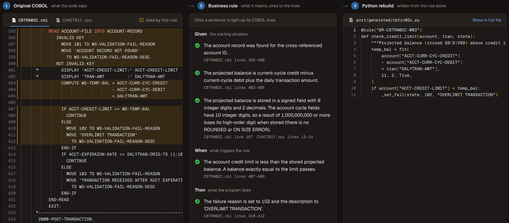

# Legibol

Legibol reads legacy COBOL, writes its business rules in plain English, and proves them, by citing every line and by rebuilding the program from the rules alone and diffing it against the original.

## Why it matters

Legibol extracts business rules from the legacy code, and every clause cites the exact
source lines it came from. Each rule is then checked against the unchanged legacy program:
a Python port written from the rules alone must produce the same outputs. A named reviewer
can then approve or reject each rule, with a note, in the review UI.

<!-- TODO: add a screenshot of the rule detail page at docs/img/rule-detail.png -->


## How it works

Legibol runs on two AWS CardDemo batch COBOL programs: **CBTRN02C** (daily transaction
posting) and **CBACT04C** (interest calculation).

1. **Parse** (code). A deterministic parser reads divisions, paragraphs, the PERFORM graph
   and PIC layouts.
2. **Extract** (AI). The extractor writes the business rules as plain-English
   Given/When/Then scenarios. Every clause cites exact source lines.
3. **Check citations** (code, then AI). Every citation is checked, first deterministically
   and then with an LLM judge.
4. **Blind Python port** (AI). The modernizer writes a Python port from the traced rules
   only. The port never sees the COBOL.
5. **Generate tests** (AI). The test generator writes branch and boundary fixtures.
6. **Run COBOL and port side by side** (code). The **unchanged** COBOL runs under GnuCOBOL
   3.1.2 in Docker, and the port runs on the same inputs. The outputs are diffed field by
   field.
7. **Coverage** (code). A `-ftraceall` build reports statements that no rule cites and no
   case executes.

AI drafts. Code or a person checks everything the AI produces.

A review UI shows the result. Its pitch: nothing unsourced, nothing unverified.

The full build spec is in [`docs/SPEC.md`](docs/SPEC.md), for anyone who wants it.

## Results

| | First run → current run |
|---|---|
| Rules verified | 2 of 12 → **12 of 12** |
| Generated cases matching legacy | 19 of 41 → **58 of 58** |
| CardDemo sample data | Current run: **matches field for field on both programs** |

First-run figures are from commit `675ecfe`. See [History](#history) for what changed.

### Detailed results (committed run, replayable from `cache/llm/`)

| | |
|---|---|
| Legacy harness, sample data | CBTRN02C: 300 transactions, **38 rejects, all reason 102**, rc 4, 251 traced lines. CBACT04C, run on the posted files: account 50's **$18.77** interest transaction is written, but its balance and cycle totals never change |
| Rules extracted | 12 (CBTRN02C 7, CBACT04C 5), a 12-rule cap we set for the build |
| Verifier | **12 of 12 traced**. 31 clauses cite extra spans (`also`); retries kept 47 unchanged passing clauses; 20 unprovable observations sit in reviewer notes |
| Generated cases | **58 of 58 match legacy** |
| Rule status after the harness | **12 verified** |
| CBTRN02C sample data | Matches field for field: 38 rejects, 262 transactions, 50 accounts, 100 category balances, rc 4 |
| CBACT04C sample data | Matches field for field: 50 interest transactions (timestamps masked), 50 accounts, rc 0 |
| Coverage (`-ftraceall`) | CBTRN02C: 233 of 339 statements executed by some case, 104 neither cited nor executed. CBACT04C: 206 of 294 executed, 80 neither |

## What it found on its own

The extractor found these on its own:

- 103 overwriting 102 (BR-CBTRN02C-004)
- `WS-TEMP-BAL` high-order truncation in the limit check (BR-CBTRN02C-003)
- reason 109 set after posting and never acted on (BR-CBTRN02C-007, in a reviewer note)
- the last-account bug (BR-CBACT04C-002 then[3])

It did not spell out the payments-make-the-limit-check-stricter finding.

## Reproducible without an API key

Every Claude call is cached in `cache/llm/<agent>/<sha256 of the request>.json`. Re-running
replays deterministically. To prove that nothing is called live:

```bash
LEDGER_REPLAY_ONLY=1 .venv/bin/python -m ledger.pipeline all   # fails on any cache miss
```

No API key is needed for this. On the committed cache this makes 75 cache hits and 0 API calls, and reproduces
`rules.json` and `results.json` exactly. Only the Docker runs are live, about 5 seconds in all.

## Team

- Kobe Cortez
- Alex Nguyen
- Love Oluwaleye

## Setup

Prerequisites: Docker, Python 3.11+ (built with 3.13), Node 20+ (built with 22), macOS or Linux.

```bash
git clone https://github.com/kbcrtz/legibol && cd legibol

# CardDemo is gitignored: clone it into vendor/carddemo (built against commit 59cc6c2, 2025-10-16)
git clone https://github.com/aws-samples/aws-mainframe-modernization-carddemo vendor/carddemo
git -C vendor/carddemo checkout 59cc6c2fd7ebd7ef7925cad552a01a4b8b6e4d5e   # optional, for exact line numbers

python3 -m venv .venv && .venv/bin/pip install -r requirements.txt
cp .env.example .env        # optional: set ANTHROPIC_API_KEY only for a fresh run; replay needs no key

# GnuCOBOL 3.1.2 image (debian:bookworm-slim + gnucobol3); the harness also builds it on demand
docker build -t ledger-cobol:3.1.2 harness/docker

cd frontend && npm install && cd ..
```

Line numbers in rules depend on the CardDemo revision, so check out the commit above to
reuse the committed rules and cache.

## Run the pipeline

```bash
.venv/bin/python -m ledger.pipeline all          # parse, extract, port, testgen, verify, coverage
```

Each stage can also run on its own:

```bash
.venv/bin/python -m ledger.pipeline parse        # deterministic parser   -> data/parsed/
.venv/bin/python -m ledger.pipeline extract      # extractor + verifier   -> data/rules.json
.venv/bin/python -m ledger.pipeline port         # modernizer             -> port/generated/*.py, data/port.json
.venv/bin/python -m ledger.pipeline testgen      # test generator         -> data/tests.json
.venv/bin/python -m ledger.pipeline verify       # GnuCOBOL vs port       -> data/results.json
.venv/bin/python -m ledger.pipeline coverage     # -ftraceall report      -> data/coverage.json
```

To replay from the cache with no API calls, see
[Reproducible without an API key](#reproducible-without-an-api-key).

Tests (codec, citation checker, and the harness acceptance checks we set for the build; the latter needs Docker):

```bash
.venv/bin/python -m pytest -q tests
```

## Start the review UI

```bash
.venv/bin/uvicorn backend.app:app --port 8000              # API (FastAPI)
cd frontend && npm run dev                                 # UI at http://localhost:3000
# or: npm run build && npm start
# point the UI at another API with NEXT_PUBLIC_LEDGER_API=http://host:port
```

The UI has these screens:

- **Rules** (`/`): the catalog. Totals (verified, flagged, approved, diverged), cases
  matching, the sample-data result per program, and filters by program and status.
- **Rule detail** (`/rules/BR-…`): Given/When/Then on the left. Click a clause to
  highlight its lines in the read-only Monaco view of the COBOL; failed clauses show the
  checker errors and the judge's reason. The legacy-vs-port cases sit below. Expand one to
  see the differing fields, the output records side by side, the fixture, and the COBOL
  lines the case executed. You can approve or reject with a name and a note, and there is
  an audit trail.
- **Change impact** (`/rules/BR-…/impact`): edit clauses and see the linked lines, data
  names, port functions, tests and other rules go stale. Re-verify regenerates only that
  rule's port code (cached) and re-runs every case of the program, plus sample data,
  against the unchanged COBOL. You can then approve the mismatches as an intended
  divergence, with your name and reason.
- **Coverage** (`/coverage`): statements no rule cites and no case executes.
- **Pipeline log**: a side panel with agent steps, verifier rejections, retries, gaps and
  mismatches.

## Demo script: the scripted change-impact edit

`demo/change_impact_edit.json` holds the edit to BR-CBACT04C-002 (the last account gets its
interest). Its regenerated port and verifier results are already in the cache. You can type
the same clause text in the UI, or run:

```bash
curl -X POST localhost:8000/api/rules/BR-CBACT04C-002/edit -H 'content-type: application/json' -d @demo/change_impact_edit.json
curl -X POST localhost:8000/api/rules/BR-CBACT04C-002/reverify
```

Then approve the divergence in the UI. To start over, delete `data/review/BR-CBACT04C-002.json`.
Re-verify reuses the CBTRN02C sample-data outputs in `data/runs/` (gitignored), which CBACT04C's
sample run chains from. On a fresh clone, run `python -m ledger.pipeline verify` once first.

## How it is built

```
harness/docker/Dockerfile     debian:bookworm-slim + gnucobol3 (GnuCOBOL 3.1.2, Berkeley DB indexed files)
harness/build.sh              compiles the unchanged programs (-fsign=EBCDIC), traced builds, helpers
harness/run_cases.sh          per case: load indexed files, run with DD_* + COB_CURRENT_DATE, dump outputs, trace run
harness/cobol/                LDLOAD (fixed-width -> indexed), LDDUMP (indexed -> fixed-width),
                              RUN04C (CBACT04C driver, PARM '2022071800'), CEE3ABD (abend stub)
ledger/cobol/                 deterministic parser: divisions, paragraphs, PERFORM graph, PIC layouts with offsets
ledger/codec.py               fixed-width encoder/decoder from copybook layouts, {ABCDEFGHI / }JKLMNOPQR overpunch
ledger/llm.py                 Claude client: manual tool loop, structured outputs, disk cache
ledger/agents/                extractor, verifier (deterministic check + judge), modernizer, test generator
ledger/harness/               Docker runner, output readers, field-by-field compare
ledger/impact.py              re-verify an edited rule
ledger/pipeline.py            CLI orchestrating the stages
port/shell.py, port/runtime.py  hand-written port shell (I/O and record parsing only) and COBOL numeric helpers
port/generated/               modernizer output; do not edit by hand
backend/app.py                FastAPI review API
frontend/                     Next.js 15 + Tailwind 4 + @monaco-editor/react
data/                         pipeline outputs (data/review/ holds human decisions; data/runs/ is scratch, gitignored)
cache/llm/                    cached Claude requests and responses (commit this for replay)
```

LLM: `claude-opus-5-5` through the Anthropic Python SDK. The agents use adaptive thinking
and structured outputs (`output_config.format`) for final answers, with tool calls for
lookups: the extractor's `get_paragraph`, `get_lines` and `get_field`, and the test
generator's deterministic `check_fixture`. Requests opt into server-side refusal fallback
(`fallbacks: "default"`, beta `server-side-fallback-2026-07-01`). Set `LEDGER_MODEL` to
override the model.

## Design decisions

- **Sample data for CBACT04C.** The raw `tcatbal.txt` has all-zero balances. So the
  CBACT04C "sample data" run uses the TCATBAL and ACCOUNT files that CBTRN02C posted,
  mirroring the real job order (POSTTRAN, then INTCALC). This reproduces the expected
  $18.77 for account 50.
- **Loader input format.** The loader reads fixed-width records with no newlines. Python
  strips CR/LF from the ASCII sample files and pads short records (cardxref lines are 36
  bytes; FILLER is padded to 50). CBTRN02C and CBACT04C each get an xref file whose keys
  match their own SELECT clause; CBACT04C's has the alternate key on account id.
- **CEE3ABD stub.** It prints `LEDGER-ABEND` and ends the run with RC 12. The port's `Abend`
  maps to the same outcome. Comparisons check the run outcome (`rc=N` or `abend`) plus
  every output file.
- **Masked fields.** `TRAN-PROC-TS` is masked in CBTRN02C. Both `TRAN-ORIG-TS` and
  `TRAN-PROC-TS` are masked in CBACT04C, which fills both from the clock. The clock is
  frozen with `COB_CURRENT_DATE=2022/07/18 12:00:00`.
- **Output order.** Indexed outputs are dumped in key order. CBACT04C's sequential
  TRANSACT file is compared in write order.
- **Rule allotment.** We capped the build at 12 rules, so extraction runs over six
  fixed units whose `max_rules` sum to 12 (`ledger/units.py`). The focus notes say only
  which part of the program a unit covers, never what the code does.
- **Extractor prompt revision (disclosed).** After the first trial run on one unit, the
  verifier rejected clauses that bundled a record-layout fact into a statement about
  logic. We added one instruction: one checkable fact per clause, with layout facts citing
  their declaration. Later revisions (see git log): clauses may cite up to two extra spans
  under `also`; rules are capped at 8 clauses; claims that something never happens go to
  unverified `notes`, which the port and test generator never see.
- **Verifier details.** The deterministic check requires:
  - every listed field (as a whole token) and literal to appear in the cited
    non-comment lines;
  - spans of 30 lines or fewer, in the program or one of its copybooks;
  - at least one field or literal per clause.

  The judge (effort medium) sees the cited lines with 4 lines of context and must find
  each clause supported. A rule with any failing clause is retried once through the
  extractor, then flagged.
- **What the modernizer sees.** It gets the traced rules (clause text, data names and
  literals, with no line spans), the copybook layouts, and the documented shell API. A
  guard refuses to send the prompt if it contains 2 or more consecutive source lines or
  more than 5 source lines. A rule's own text may quote a single statement; two traced
  CBACT04C clauses quote `PERFORM 1050-UPDATE-ACCOUNT`, and the guard logs this. Working-storage PICs reach
  it only when a rule states them (for example the `WS-TEMP-BAL` size in BR-CBTRN02C-003).
  It is told not to use outside knowledge of CardDemo. That can't be enforced, which is
  why the sample-data run matters.
- **Port shell.** The hand-written shell does file I/O only. It exposes records as dicts
  keyed by copybook field names (Decimal for scaled numerics, int otherwise, padded str
  for alphanumerics), and offers `write_reject`, `write_transaction` (a duplicate key
  becomes an abend, as an indexed WRITE would) and a frozen `now()`. All control flow and
  business logic are in the generated module.
- **Test oracle.** Generated expectations are notes only. Pass or fail always comes from
  comparing legacy with the port.
- **Sample data per rule.** The sample-data run is reported per program, not counted
  toward any single rule's verified status.
- **Human approval of flagged rules.** If a named reviewer approves a rule the verifier
  flagged, the next `pipeline port` / `testgen` / `verify` includes it. This is logged as
  `human-approved`, and its harness result is still recorded. No rule has been approved.
- **Stale.** A rule is shown as stale if it has an unverified edit, or if the hash of its
  cited lines or of the port module differs from what was recorded at verification time.
- **Re-verify.** It writes the edited port to a separate module
  (`port/generated/<prog>_edit_<rule>.py`), so the verified port stays intact. The
  modernizer prompt includes only the changed clauses (not the editor's name), so a
  scripted edit replays from cache.
- **Coverage.** Executable lines are lines that start a COBOL statement. That is what
  `-ftraceall` reports; ELSE, END-IF and continuation lines don't count. The 251 traced
  lines for the CBTRN02C sample data (see Detailed results) are the raw trace count
  including paragraph entries; 226 of those are statement lines.
- **Monaco.** `@monaco-editor/react` loads the editor from its default CDN (jsDelivr), so
  the UI needs network access the first time.
- **No mock data.** The UI was built against real pipeline output, so `fixtures/mock/` is
  not needed.

## Known gaps

- No human has approved or rejected any rule yet; "verified" means the citations and the
  legacy-vs-port tests passed, not that a reviewer signed off.
- The scripted change-impact edit (`demo/change_impact_edit.json`, BR-CBACT04C-002 then[3])
  regenerates the port with the last-account update. Re-verify then shows 21 expected
  mismatches; on the sample data the only difference is account 50's balance and cycle totals.
- Re-verify after an edit doesn't change `data/rules.json`. The edit, results and
  divergence approval live in `data/review/<rule>.json`, and the UI overlays them.
- A clause-text edit is the only kind of edit supported (no adding or removing clauses, no
  re-citing lines).
- Stretch goals we did not build: the cross-program view and the drift report.

## History

The first run verified only 2 of 12 rules. Each clause could cite only one span,
so true facts that needed a program line plus a copybook declaration failed the judge, and
retries re-judged clauses that had already passed. The fixes are in the git log (multi-span
citations, retries that re-check only changed clauses, absence claims moved to notes).
